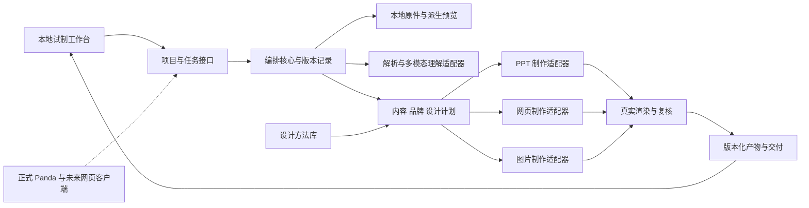

# 架构与客户端接入

## 当前怎样运行，模型与 Skill 怎样接入

2026-10-12 更新至 v0.10：独立本地工作台已接通服务端模型 API，并按分析、讨论、规划与局部改稿装载 Panda 专业方法。本轮通过界面完成了 15 张图片预览与 6 份文档提取文本的分析、对话、规划、局部改稿和导出，实际生成 10 页 PPTX、离线 HTML 与 10 张 PNG；PPTX 含原生文字和独立图片对象。171 项自动化测试通过。PowerPoint/WPS 人工打开编辑尚未验证，审美尚未获用户确认。

当前默认由 `gem-3.8-flash` 分析、对话与改稿，`tt-6.1-sol` 规划。平台 ID 不证明官方上游身份。本轮 TT 改稿曾超时，失败请求最终退款、实扣为零；切换配置后由 gem 完成改稿。共 4 次成功、1 次失败，合计实扣 0.4277 算力，不据此保证后续费用或耗时。

用户暂不要求正式 Panda 部署接口，先把本地使用路径跑通并维护完整代码。v0.9 及更早版本依赖助手分析后写入底稿；这部分历史 workflow 与新模型结果分开展示，尚未自动合并，不能混作同一次模型阅读。

| 运行方式 | 谁提供理解与执行 | 当前状态 |
| --- | --- | --- |
| 助手加载 Skill | Codex 等实际支持该包的宿主，提供模型、文件工具和可用制作工具 | 当前可由助手执行；其他宿主须核验其工具能力，不能只因能聊天就称兼容 |
| 独立本地网页/软件 | 后台调用模型 API、装载适用 Skill 与资源、调度解析/制作/渲染工具，保存对话与版本 | 四个模型入口和 PPTX/HTML/PNG 导出已通过界面真实试跑；目标软件人工编辑与审美验收尚未完成 |

Skill 是工作方法与资源，模型 API 是理解和规划能力，制作器才写出实际 PPTX/HTML/图片。接入聊天接口不等于获得 Codex 整套工具执行环境；把 SKILL.md 放进仓库也不等于它已参与制作。

形成 PPT 不必每次让模型自由生成并执行程序：模型可以在模板和工具支持范围内产出结构化内容/布局计划，由经过验证的制作器执行。需要自由网页或特殊视觉实现时，再启用对应作者工具或受控代码执行；无论哪条路线，必须有真实文件、渲染和局部修改验证。

本轮已根据用户提供的模型能力文档接入服务端网关。后续添加能力仍须读取原文及必要资源，区分 API 指南、宿主 Skill、模板包与可执行工具，登记实际模型 ID、输入输出及依赖。验收使用真实资料，分别记录模型调用、内容与设计结果、实际 PPTX、打开/编辑及下一轮改稿；不能以“已读取文档”“已装入提示词”或“接口返回200”作为完成。

当前动作是 `analyze`（分析资料）、`chat`（补充要求）、`plan`（生成页面）和 `revise`（只改指定页）。模型仅返回经校验的结构化数据，不执行它生成的代码。制作器现有六类版式为封面、主视觉、图文并置、图片组、文字叙述与图纸说明；这限制了可表达的设计范围，不能把它称为任意版式作者或成熟杂志设计系统。

## 结构

Skill 定义专业判断；代码约束状态、版本、文件和执行；模型提出内容与设计；制作器输出实际对象。不能把一个长提示词同时当解析器、渲染器和任务系统。

## 后续正式宿主接入

本仓库不实现第二套正式账号、积分、支付或客户管理。本地试制通过服务端配置选择模型和读取密钥，正式接入时应适配 Panda 已有网关。正式 Panda 客户端技术栈未知；核心参考实现用无依赖 Node ESM，边界采用 JSON。若正式客户端使用其他语言，可按契约重写核心或通过受控进程/服务调用，不要求换桌面框架。

接入有三个可选边界：宿主直接导入模块；本地子进程通过结构化消息通信；宿主调用已有可信服务。确定方式前须读正式产品仓库。不要因本机存在名称相似的候选软件而绑定其端口。

## 数据与目录

每个项目的事实、素材、品牌、设计与产物分别版本化，以 project_id / asset_id / content_id / artifact_id 关联。原件不可覆盖；派生预览、编辑图、PPT 与网页均保存来源。异步任务持有输入快照，完成时再次核对实际依赖。

当前单机工作台已有项目文件存储、会话 token、同源与路径检查、项目写入锁和双版本更新；它们不是多用户生产服务。生产存储将来可由既有客户端提供，任务队列、数据库和多租户授权仍需对应实现。纯函数校验不代替持久化层的原子提交。

API Key 从服务端 `.env` 读取；可通过环境变量或忽略的 `local/ai-config.json` 指定配置。密钥不能写进 Skill、网页、导出文件、日志或公开仓库。状态接口只提供公开配置与验证状态，不提供凭据或密钥文件位置。正式接入时优先复用 Panda 已有网关。

点击模型操作会发送本次需要的项目说明、历史上下文、压缩图片预览和已提取文字，并产生调用费用；原件留在本机。读取范围、未发送原因、具体模型 ID 与已知实扣会记录，未知费用不显示为零。本地应用不等于云模型完全离线。详细输入上限与配置见[模型与技能运行](模型与技能运行_v0.10.md)。

## 模块边界与后续适配合同

以下为整体目标合同。当前已有受限文件解析、模型网关和结构化分析，以及六类页面的 PPTX/HTML/PNG 制作；图像编辑、任意固定母版继承、完整对象映射与自动视觉复核并未全部实现。

| 适配器 | 输入 → 输出 | 关键失败信息 |
|---|---|---|
| FileParser | 文件引用 → 页/布局、文字、图像、可读范围 | 加密、格式不支持、缺字体、CAD外参缺失 |
| Understanding | 可读证据 → 事实、图片角色、不确定项 | 未见页面、证据不足、结构无效 |
| ModelGateway | 能力与结构约束 → 提案 + 模型ID + 用量 | 超时、限额、结构失败、任务结果未知 |
| ImageEditor | 原图 + 具体修改 + 保护区 → 派生图与来源 | 几何改变、Logo损坏、授权已撤回 |
| PptRenderer | 逐页计划 + 品牌 + 素材 → PPTX + 对象映射 | 不支持对象、字体替换、渲染不可用 |
| WebRenderer | 内容单元 + 品牌 → HTML/CSS/资源 + 章节映射 | 资源丢失、窄屏溢出、交互不可用 |
| ImageRenderer | 构图母版 + 像素目标 → 图片 + 元信息 | 清晰度不足、裁切越界、字体缺失 |
| Review | 真实产物及渲染 → 位置明确的问题 | 无渲染、版本不符、未覆盖全部页 |

模型用能力标签路由：图像理解、文档长上下文、结构化输出、复杂设计推理、图像编辑。用户提到的模型名字先作为候选别名，接入时核实供应商 ID、实际多模态能力、区域与成本；不得静默换模型或杜撰可用版本。

## 修改与故障恢复

当前模型任务使用项目快照，在服务端调用期间不持有写入锁。返回时再次检查版本；用户已修改项目时，模型结果只保留为本机候选，不覆盖新稿。失败不自动重试付费请求。

更新分析或补充要求后，旧模型页面标记为待重新编排；说明、受众或素材实际变化后，分析也会过期。重新分析、生成页面之前禁止把旧页当新内容导出，局部改一页不能解除整套过期状态。相同内容的重复保存不会误标过期。旧规则编排保留为明确命名的独立功能。

未来任务合同中，service_status 记录服务是否完成，adoption_status 记录本项目是否可以采用。上游任务查询与取消应按实际支持能力接入；当前不声称已实现通用取消或任务查询。超时且受理结果未知时不能直接再次扣费提交；停止采用不等于上游停止计费。

PPT 手改回传应保留前后文件，优先依据内容 ID、对象名与指纹恢复关联；该回传适配尚未实现。页码仅表示位置。冲突才问具体字段，其他修改继续纳入。生产采用结果必须再次核对版本；当前单机服务的项目锁与修订号不替代未来多进程或数据库事务。

## 展示设计

客户端围绕三个问题展示：我给了什么、Panda理解了什么、结果还有哪里需要改。左侧资料与章节，中间成品，右侧对话与当前页设计说明。默认不显示提示词、向量分数或多代理内部日志；需要追溯时展开来源与处理记录。

预览中的“PPT / 网页 / 杂志”切换改变排版，保留共享内容。固定封面、Logo 和图纸保护可直观看见；修订时先显示影响了哪些页/章节。进度报告“已读多少资料、正在设计哪些页、哪里受阻”，不编造精确百分比。
