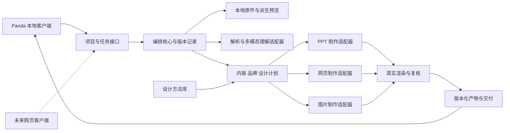

# 架构与客户端接入

## 结构

Skill 定义专业判断；代码约束状态、版本、文件和执行；模型提出内容与设计；制作器输出实际对象。不能把一个长提示词同时当解析器、渲染器和任务系统。

## 先接现有宿主

本仓库不实现第二套账号、积分、支付、模型配置或客户管理。正式 Panda 客户端技术栈未知；核心参考实现用无依赖 Node ESM，边界采用 JSON。若正式客户端使用其他语言，可按契约重写核心或通过受控进程/服务调用，不要求换桌面框架。

接入有三个可选边界：宿主直接导入模块；本地子进程通过结构化消息通信；宿主调用已有可信服务。确定方式前须读正式产品仓库。不要因本机存在名称相似的候选软件而绑定其端口。

## 数据与目录

每个项目的事实、素材、品牌、设计与产物分别版本化，以 project_id / asset_id / content_id / artifact_id 关联。原件不可覆盖；派生预览、编辑图、PPT 与网页均保存来源。异步任务持有输入快照，完成时再次核对实际依赖。

生产存储可由现有客户端提供；本仓库只有资源登记脚本与虚构示例。任务队列、数据库、账号隔离、文件访问控制及服务端授权还未实现。纯函数校验不代替服务端身份校验和原子提交。

本地模型密钥不可放到网页或导出文件。优先复用 Panda 已有网关；若客户端直连，凭据只经宿主安全存储取用。用户文件何时发给哪个服务，由实际能力、授权与项目设置共同决定。本地应用并不意味着云模型完全离线。

## 建议的适配合同（尚未实现）

| 适配器 | 输入 → 输出 | 关键失败信息 |
|---|---|---|
| FileParser | 文件引用 → 页/布局、文字、图像、可读范围 | 加密、格式不支持、缺字体、CAD外参缺失 |
| Understanding | 可读证据 → 事实、图片角色、不确定项 | 未见页面、证据不足、结构无效 |
| ModelGateway | 能力与结构约束 → 提案 + 模型ID + 用量 | 超时、限额、结构失败、任务结果未知 |
| ImageEditor | 原图 + 具体修改 + 保护区 → 派生图与来源 | 几何改变、Logo损坏、授权已撤回 |
| PptRenderer | 逐页计划 + 品牌 + 素材 → PPTX + 对象映射 | 不支持对象、字体替换、渲染不可用 |
| WebRenderer | 内容单元 + 品牌 → HTML/CSS/资源 + 章节映射 | 资源丢失、窄屏溢出、交互不可用 |
| ImageRenderer | 构图母版 + 像素目标 → 图片 + 元信息 | 清晰度不足、裁切越界、字体缺失 |
| Review | 真实产物及渲染 → 位置明确的问题 | 无渲染、版本不符、未覆盖全部页 |

模型用能力标签路由：图像理解、文档长上下文、结构化输出、复杂设计推理、图像编辑。用户提到的模型名字先作为候选别名，接入时核实供应商 ID、实际多模态能力、区域与成本；不得静默换模型或杜撰可用版本。

## 修改与故障恢复

service_status 记录服务是否完成；adoption_status 记录本项目是否可以采用。超时且受理结果未知时先查询原 job_id，不能直接再次扣费提交。取消后若上游迟到，只存历史候选，不覆盖用户新稿；停止采用不等于上游停止计费。

PPT 手改回传保留前后文件，优先依据内容 ID、对象名与指纹恢复关联；页码仅表示位置。冲突才问具体字段，其他修改继续纳入。生产采用结果必须在事务中再次核对版本；本仓库纯函数是规则参考，不提供并发锁。

## 展示设计

客户端围绕三个问题展示：我给了什么、Panda理解了什么、结果还有哪里需要改。左侧资料与章节，中间成品，右侧对话与当前页设计说明。默认不显示提示词、向量分数或多代理内部日志；需要追溯时展开来源与处理记录。

预览中的“PPT / 网页 / 杂志”切换改变排版，保留共享内容。固定封面、Logo 和图纸保护可直观看见；修订时先显示影响了哪些页/章节。进度报告“已读多少资料、正在设计哪些页、哪里受阻”，不编造精确百分比。
